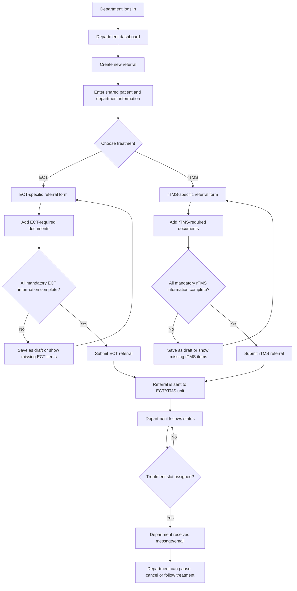
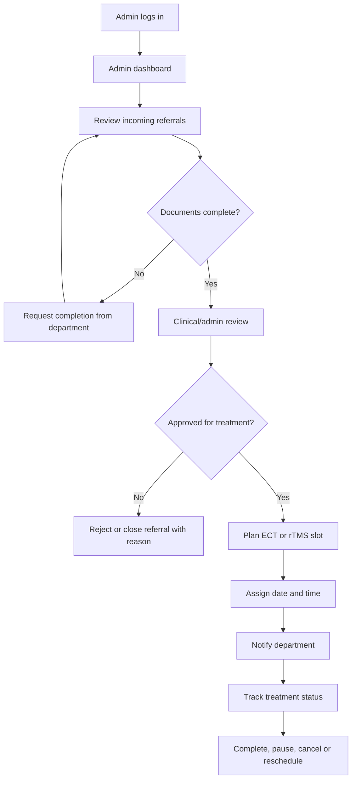
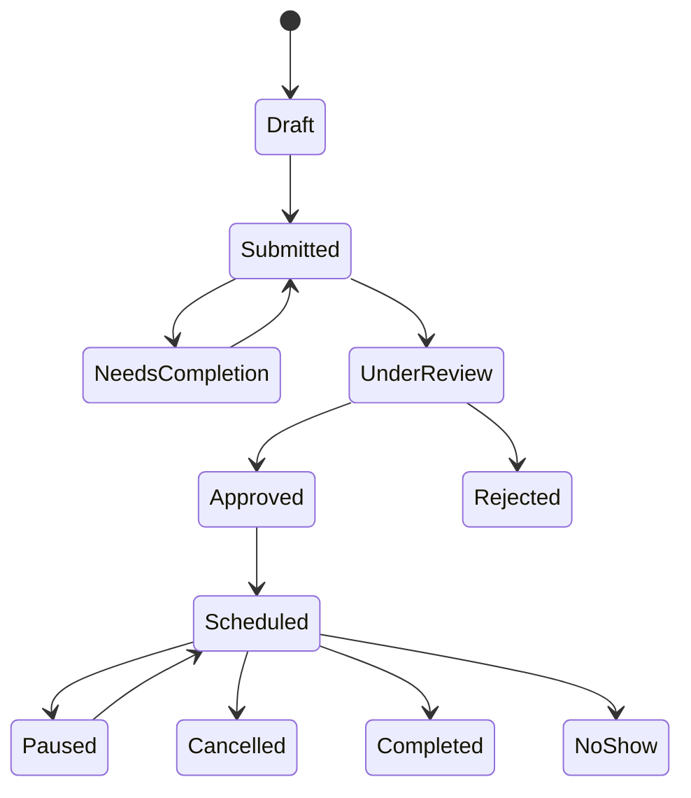

# Product Plan: ECT/rTMS Referral and Booking System

## Purpose

The system should become one shared booking and referral platform for psychiatric ECT and rTMS treatments. It should support inpatient wards, outpatient clinics and, later, external referrals from primary care.

The main goal is to make the workflow clearer, safer and easier for staff:

- Departments can create referrals, request or book treatment times, follow status, pause treatment and cancel times.
- The ECT/rTMS treatment unit can review referrals, check required documents, plan capacity and assign treatment slots.
- No referral should move forward if mandatory patient information or documents are missing.

## Key Terms

**ECT** means electroconvulsive therapy. It is a psychiatric treatment where a controlled electrical stimulus is given under anesthesia to trigger a brief seizure, often used for severe depression, catatonia or other serious psychiatric conditions.

**rTMS** means repetitive transcranial magnetic stimulation. It is a non-invasive treatment where magnetic pulses stimulate specific brain areas, often used for depression when other treatments have not been enough.

## User Groups

### Department Portal

Used by inpatient wards, outpatient clinics and other psychiatric departments.

Main users:

- Doctors
- Nurses
- Coordinators
- Department staff with permission to manage referrals and bookings

Main tasks:

- Create a new referral
- Add patient and treatment information
- Upload or confirm required documents
- Request or book treatment time
- Follow referral status
- Pause treatment
- Cancel a booked time
- Receive notification when the patient has been assigned a treatment slot

### Admin Portal

Used by the ECT/rTMS treatment unit and administrators.

Main users:

- ECT/rTMS coordinators
- Treatment staff
- Admin users
- Possibly doctors or anesthesia staff depending on local workflow

Main tasks:

- Review incoming referrals
- Check if required documents are complete
- Approve, reject or request completion
- Assign treatment slots
- Manage ECT and rTMS schedules
- Track paused, cancelled and urgent cases
- Notify departments when a patient has received a time
- Follow statistics and quality indicators

## Treatment Units and Care Logistics

The system should support more than one treatment unit. The first version should still use two portals, but the admin portal must be able to work with several physical units.

Recommended treatment units:

- **Sahlgrenska ECT/rTMS main unit**
  - Main ECT/rTMS unit.
  - ECT is normally performed Monday, Wednesday and Friday, 09:00-12:00.
  - rTMS is normally performed every weekday, 13:00-16:00.
  - Current operational capacity should be modeled as **15 patients per treatment session**.
  - A future development plan is to support 5-minute slots, but the current MVP should not assume 5-minute scheduling.
  - Polyclinic ECT patients should have a visible capacity category, often around 3 places per ECT session.
  - Acute ECT may need to be handled outside the regular Monday/Wednesday/Friday flow.

- **Östra ECT unit**
  - Smaller ECT unit in the psychiatry building at Östra.
  - Around 6 patients.
  - Should exist in the system, but can be treated as limited/secondary until the workflow is stable.

- **Mölndal/Psychosis ECT unit**
  - Mainly for psychosis wards 240, 241 and 242.
  - Can occasionally help relieve Sahlgrenska when the main unit is overloaded and it is clinically suitable.

Recommended default routing:

- Östra inpatient wards 361, 362, 363, 365, 366, 367, 368 and the psychiatric emergency department usually route to Sahlgrenska ECT.
- Sahlgrenska wards 80, 81 and 364 usually route to Sahlgrenska ECT and normally do not require the same transport planning.
- Psychosis wards 240, 241 and 242 usually route to Mölndal/Psychosis ECT.
- Outpatient/polyclinic ECT usually routes to Sahlgrenska ECT.
- rTMS should route to Sahlgrenska rTMS in the first version.

The system should show a **transport flag** when a patient is not treated at the same site as their ward. This is especially important for Östra wards whose patients need transport to Sahlgrenska. The flag should remind staff to plan transport, escorting staff and any extra staffing needed for difficult psychiatric cases.

The transport flag is not a separate referral. It is a visible planning warning attached to the referral or booking.

## Department Workflow

## Referral Form Structure

The referral flow should start in the same place, but ECT and rTMS should not feel like the same referral. The user should first enter shared information and then choose the treatment type. After that choice, the system should open the correct clinical form.

Shared first step:

- Patient identity
- Referring department or clinic
- Responsible doctor
- Contact person
- Priority
- Preferred start date or preferred treatment period
- Short reason for referral

ECT referral section:

- ECT indication
- Acute, planned, maintenance or index series
- Anesthesia-related information
- Fasting or preparation information
- Somatic risk assessment
- Medication and allergy review
- Health declaration
- Required ECT documents or confirmations

rTMS referral section:

- rTMS indication
- Depression, OCD, anxiety or other indication
- Previous treatment attempts
- Contraindication checklist
- Metal implants or medical device information
- Seizure history
- Neurological risk factors
- Requested treatment protocol or treatment goal

This means the system should behave like:

**New referral -> shared patient information -> choose ECT or rTMS -> treatment-specific referral -> required document check -> submit.**

## Admin Workflow

## Suggested Status Model

Recommended statuses:

- **Draft**: The department has started a referral but has not sent it.
- **Submitted**: The referral has been sent to the ECT/rTMS unit.
- **Needs completion**: Required information or documents are missing.
- **Under review**: The treatment unit is reviewing the referral.
- **Approved**: The referral is accepted and ready to be scheduled.
- **Scheduled**: The patient has received a treatment slot.
- **Paused**: Treatment is temporarily paused.
- **Cancelled**: The booking or referral has been cancelled.
- **Completed**: Treatment or treatment series is completed.
- **Rejected**: The referral was not accepted.
- **No-show**: The patient did not attend a booked treatment.

## Backend API Contract

The first backend contract for referrals, action notes and timeline events is documented in [`BACKEND_REFERRAL_API.md`](./BACKEND_REFERRAL_API.md).

The current frontend prototype still uses local browser storage for some referral actions, but the intended backend model is:

- `Referral` for the clinical request.
- `ReferralAction` for completion requests, department responses, prioritization decisions and confirmed times.
- `ReferralDocument` for required documents/checklists.
- `ReferralRiskFlag` for clinical/admin warnings, including anesthesia attention.

## Referral vs Booking

A referral and a booking should be treated as two different things.

**Referral**:

- Contains the medical request.
- Must include patient information, indication, priority and required documents.
- Can be submitted, reviewed, completed, approved or rejected.

**Booking**:

- Contains the actual date, time and treatment slot.
- Should only be confirmed after the referral is approved.
- Can be changed, paused or cancelled.

The department can request a preferred time, but the ECT/rTMS unit should confirm the final slot.

## Required Information and Documents

The exact requirements should be decided with the clinic, but the system should support a checklist.

Common information:

- Patient identity
- Referring department or clinic
- Responsible doctor
- Contact person
- Treatment type: ECT or rTMS, which decides which referral form opens
- Priority level
- Clinical indication
- Relevant diagnosis or reason for treatment
- Current medication
- Allergies
- Risk factors
- Previous ECT or rTMS treatments
- Consent or confirmation that patient information has been handled correctly

Possible ECT-specific requirements:

- Anesthesia-related information
- Fasting or preparation instructions
- Somatic risk assessment
- Medication instructions before treatment
- Required forms or health declaration

Possible rTMS-specific requirements:

- Contraindication checklist
- Metal implants or medical device information
- Seizure history
- Treatment protocol or requested indication

## Recommended Home Pages

### Department Dashboard

The department view should not start with only instructions. It should show what the department needs to act on.

Recommended content:

- Active referrals
- Referrals needing completion
- Booked treatment times
- Upcoming ECT/rTMS slots for the department's patients
- Quick actions:
  - New referral
  - Request treatment time
  - Pause treatment
  - Cancel time
- Simple ECT and rTMS overview showing available capacity or current status

### Admin Dashboard

The admin view should focus on daily operations.

Recommended content:

- Today's ECT and rTMS flow
- Incoming referrals
- Urgent referrals
- Referrals missing documents
- Approved referrals waiting for slot
- Today's booked patients
- Paused or cancelled treatments
- Staffing and capacity overview
- Statistics and quality indicators

## User-Friendly Design Principles

- Use separate portals for admin and department users.
- Show only the actions each user role needs.
- Use clear Swedish clinical language.
- Make missing information visible before submission.
- Allow users to save drafts.
- Use a step-by-step referral form instead of one long form.
- Show status clearly with color, label and explanation.
- Always show the next recommended action.
- Avoid hidden errors. If something cannot be submitted, explain exactly why.
- Make booking, pause and cancellation actions easy to find but require confirmation.
- Keep patient-sensitive information structured and easy to scan.

## Important Functions To Plan

- Role-based login
- Department ownership of referrals
- Required document checklist
- File upload or document confirmation
- Referral status tracking
- Admin review queue
- Booking calendar
- Treatment series for repeated ECT/rTMS sessions
- Pause and resume treatment
- Cancellation reason
- Email or in-system notification when a slot is assigned
- Audit log for patient-related changes
- Permissions per department
- Search and filtering
- Statistics and quality follow-up
- Later integration with primary care, journal systems or calendar systems

## Suggested Development Phases

### Phase 1: Internal MVP

- Separate admin and department portals
- Login with role-based access
- Create and submit referral
- Basic required field validation
- Admin review list
- Approve referral
- Assign treatment time
- Department can see booked time

### Phase 2: Safer Clinical Workflow

- Required document checklist
- Request completion from department
- Email or page notification
- Pause treatment
- Cancel treatment with reason
- Audit log

### Phase 3: Better Scheduling

- Calendar view
- ECT and rTMS capacity
- Treatment series
- Recurring slots
- Waiting list
- Priority handling

### Phase 4: Integrations

- Primary care referral flow
- Possible journal system integration
- External login or secure access
- Automatic notifications
- Reporting and quality export

## Open Decisions

Before building the full workflow, these decisions should be made:

- Which exact roles should exist?
- Which departments should be included first?
- Which documents are mandatory for ECT?
- Which documents are mandatory for rTMS?
- Should departments book a real slot, or only request a preferred time?
- Who is allowed to pause treatment?
- Who is allowed to cancel treatment?
- Should notifications be sent by email, inside the system or both?
- Should the first version include external referrals from primary care, or should that come later?

